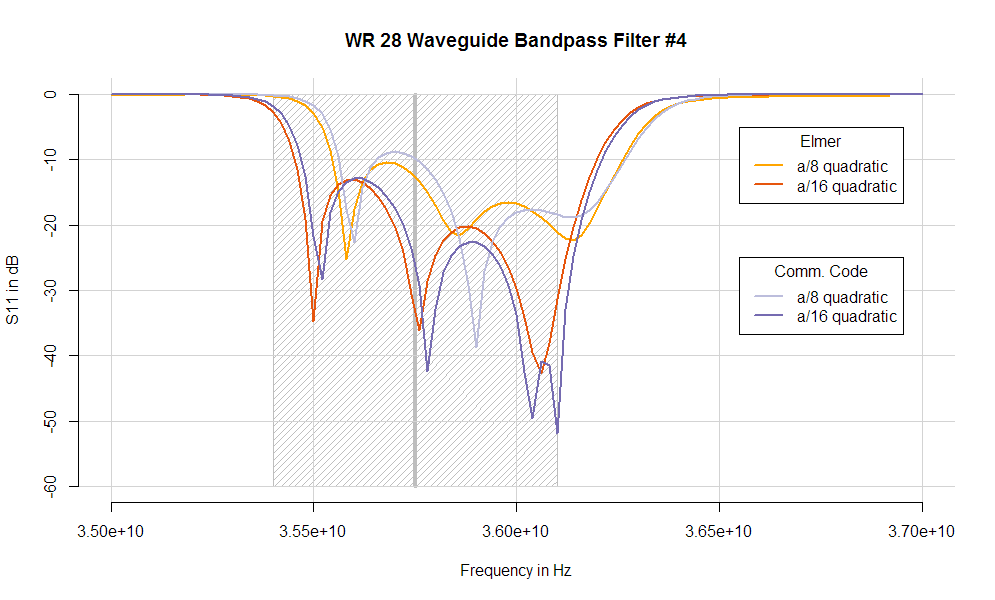
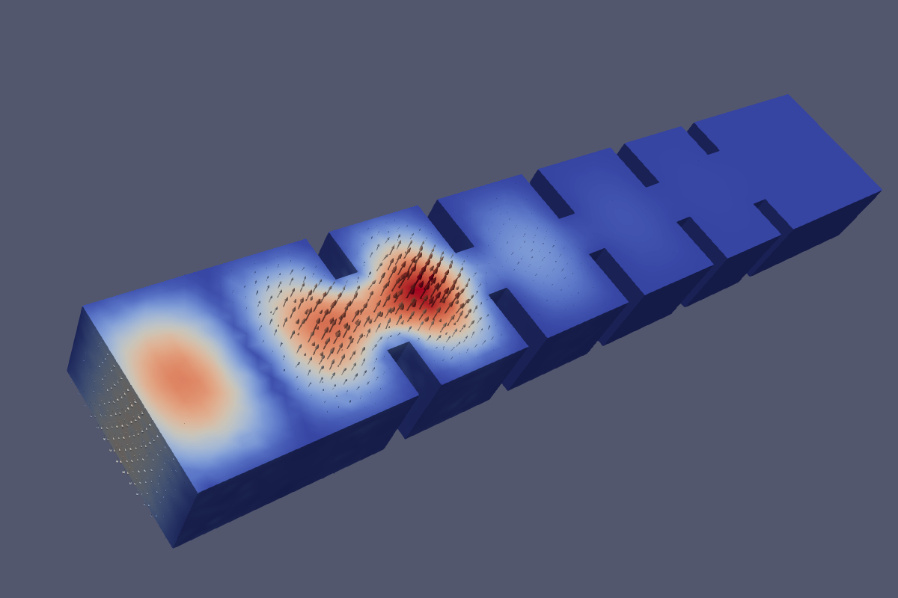

# Bandpass Filter 

This is a test case defined and created by Sirko Pamin (email: s.pamin@lzh.de).

For details about the history of the case see the thread at discussion forum:
http://www.elmerfem.org/forum/viewtopic.php?p=19791#p19791

- VectorHelholtzSolver used for harmonic electric field
- Sweeping over frequency is performed
- As a later development better strategies for the solution of linear systems are employed in the files Filter_Zhai_hierarchic.sif and Filter_Zhai_pmg.sif

