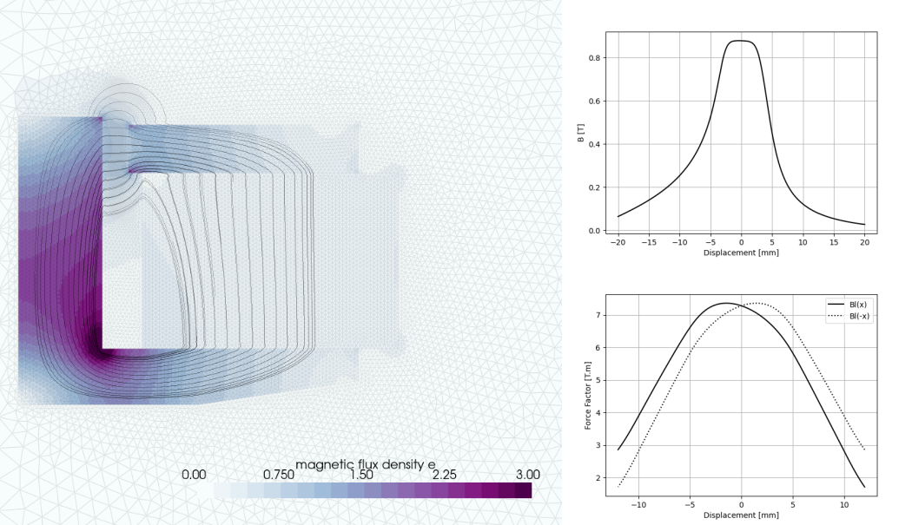

# Elmer loudspeaker motor
Example case of a simple axi-symmetric motor. The related discussion can be found [here](https://elmerfem.org/forum/viewtopic.php?t=8948).

Pre-processing (geometry+mesh) is done with gmsh, ElmerGrid is used to convert loudspeaker_axi.msh. 

The geometry is inspired by the COMSOL presentation [Modeling the Electrical Parameters of a Loudspeaker Motor System](https://www.comsol.com/paper/modeling-the-electrical-parameters-of-a-loudspeaker-motor-system-with-the-acdc-module-25451). Dimensions are approximated, and materials are not identical.

Post-processing is done in Python using [PyVista](https://docs.pyvista.org/) to generate streamlines and extracts the magnetic field in the airgap, as well as resulting force-factor.

