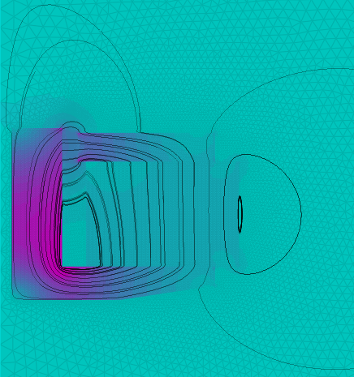
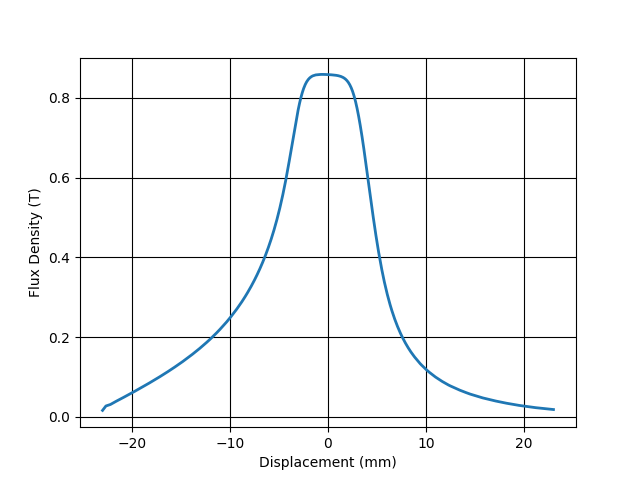

# Elmer loudspeaker motor
Example case of a simple axi-symmetric motor. 

Pre-processing is done with gmsh, ElmerGrid is used to convert loudspeaker_axi.msh. 

The geometry is based on the COMSOL presentation [Modeling the Electrical Parameters of a Loudspeaker Motor System](https://www.comsol.com/paper/modeling-the-electrical-parameters-of-a-loudspeaker-motor-system-with-the-acdc-module-25451).

Post-processing is done in Python using [PyVista](https://docs.pyvista.org/) to generate streamlines and extracts the magnetic field in the air-gap.

